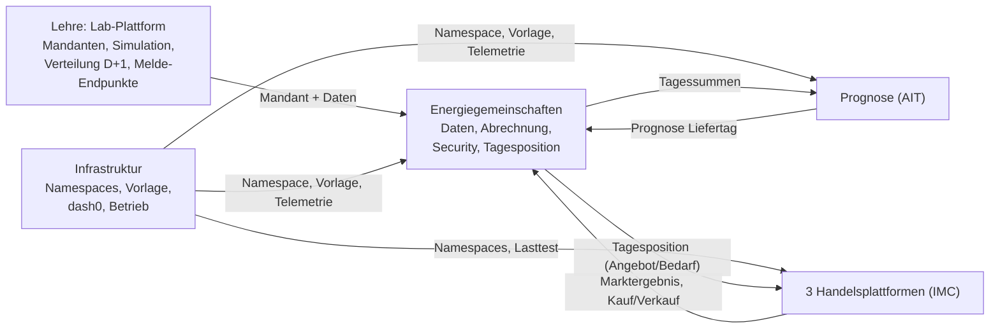

# 1 Überblick

## Worum es geht

Im Labor entsteht gemeinsam **ein verteiltes System** für Energiegemeinschaften.
Ihr baut nicht drei getrennte Projekte, sondern Teile eines Ganzen. Jedes Team
verantwortet eine Domäne, und die Teams arbeiten über **vereinbarte
Schnittstellen** zusammen.

Eine Energiegemeinschaft verteilt den Strom, den ihre Erzeuger (meist PV)
liefern, an ihre Verbraucher. Was übrig bleibt oder fehlt, handelt sie an einer
**Handelsplattform**, die den Strom ankauft, verkauft und Fehlmengen über ein
simuliertes, teures Reservekraftwerk deckt. Es fließt kein echter Strom und kein
echtes Geld; die Zähler sind simuliert oder von euch selbst gemeldet.

## Die Teams

| Team | Wer | Anzahl | Aufgabe |
|---|---|---|---|
| **Infrastruktur** | CYS + IIR (Auswahl im Labor 1) | 1, für alle | Kubernetes-Plattform für alle Teams: Namespaces, Deployments, Zugriffe, Security (RBAC), CI/CD-Vorlage, Observability mit dash0 |
| **Energiegemeinschaft** | übrige CYS + IIR | eine je Kleingruppe | Gemeinschaft betreiben: Mitglieder, Zählpunkte, Datenpipeline, Simulation und eigene Zähler, Abrechnung der Mitglieder, Security der eigenen Domäne, Tagesposition an die Handelsplattform |
| **Prognose** | AIT | 1, für alle | Prognose des Liefertags für alle Gemeinschaften als Dienst |
| **Handelsplattform** | IMC | 3 Gruppen | je Gruppe eine alternative Plattform auf demselben Datenvertrag: Positionen, Marktschluss, Zuteilung, Preis, Reservekraftwerk, Geschäfte, Abrechnung |

Die Aufgaben je Team und Meilenstein stehen auf den Seiten 7 bis 10.

## Wie die Teams zusammenhängen

Zwischen den Teams gibt es nur diese Schnittstellen. Niemand bekommt Zugang zur
Datenbank oder zum Mandanten eines anderen Teams.

## Zwei Zeitebenen: Viertelstunde und Liefertag

| Ebene | Granularität | Wo |
|---|---|---|
| **Innerhalb der Gemeinschaft** | 15 Minuten | eure Gemeinschaft: Verteilung D+1, eigene Zähler |
| **Zwischen Gemeinschaft und Handelsplattform** | **Liefertag** | Handelsplattform |

Die Plattform kennt je Gemeinschaft und Tag **eine Position**: entweder ein
Angebot oder einen Bedarf in kWh. Sie kennt keine einzelnen Smart Meter und keine
Prognose-Zeitreihen. Die Brücke baut eure Gemeinschaft:

1. **Ist-Bilanz eines Tages** aus der Verteilung D+1: Überschuss = Σ `P.01T`,
   Fehlmenge = Σ (Verbrauch − `G.03`), Netto = Überschuss − Fehlmenge
   (Register siehe [Seite 3](03-energiegemeinschaft-fachlich.md)). Bei Netto > 0 ist
   das ein Angebot, sonst ein Bedarf.
2. **Position für den Liefertag D** muss vor dem Marktschluss stehen. Der jüngste
   eingefrorene Tag ist dann D−2. Deshalb stützt sich die Position auf die
   **Prognose** für D, gerechnet aus Tageswerten bis D−2.
3. **Nach D** liefert die Verteilung D+1 das Ist. Ihr vergleicht Position und Ist.

**Marktläufe.** Im Winter erzeugt PV wenig; an fast allen echten Tagen wären alle
Gemeinschaften Käufer. Deshalb handeln die Pflicht-Marktläufe **historische
Liefertage** aus der Zwei-Jahres-Historie, Sommer und Winter gemischt. Die
Lehrenden geben je Lauf den Liefertag vor. Live-Betrieb „morgen“ ist Vertiefung.

## OctoMesh ist optional, der Datenvertrag nicht

Das Labor läuft auf **OctoMesh**, einer Data-Mesh-Plattform. Eure Gemeinschaft ist
ein Mandant darauf, die Simulation und die Melde-Endpunkte kommen von dort. Für
die **Integration** zwischen den Teams ist OctoMesh dagegen **optional und kein
Abnahmekriterium**. Verbindlich sind die vereinbarten Schnittstellen und der
gemeinsame **Datenvertrag** der Handelsplattformen (Seite 10). Wer OctoMesh
nutzt, weist bei seinen Data Products Owner, Version, Semantik, Zugriffsrechte und
Qualitätsregeln aus.

## Meilensteine

| MS | Name | Termin | Was danach gilt |
|---|---|---|---|
| **M0** | Kickoff | Fr 16.10. (Labor 1) | Teams und Gruppen stehen, Aufträge sind verteilt |
| **M1** | Plattform und Verträge stehen | ~06.11. | Jede Person ist angemeldet; jedes Team hat einen Dienst über die gemeinsame Vorlage deployt und in dash0 sichtbar; Rollenkonzept steht; **Datenvertrag Handel v1.0** ist veröffentlicht |
| **M2** | Daten der Gemeinschaften verfügbar | Ende KW47 (20.11.) | Jede Gemeinschaft stellt Zählpunkte und Tagessummen über eine rollengeschützte Schnittstelle bereit; der Prognosevertrag steht; jede Plattform besteht den Konformitätstest |
| **M3** | Integrierter Zwischenstand (etwa zwei Drittel) | ~11.12. (Termin noch offen) | Ein End-to-End-Teilprozess läuft: Abrechnung auf echten Daten, Prognose mit Fehlerkennzahl, Testmarkt mit mindestens zwei Gemeinschaften, Ablauf in dash0. Abnahme per Live-Demo |
| **M4** | Marketplace und Vertiefung | ~22.01. | Marktläufe auf vorgegebenen Liefertagen, Geschäfte in der Mitgliederabrechnung, neun Testszenarien, Restore- und Ausfallnachweis |
| **M5** | End-to-End-Demo | ~29.01. | Gesamtdemo mit Security, Observability und Reflexion; Endpräsentation |

„M1 läuft“ heißt: Ihr arbeitet auf diese Abnahme hin. M1 ist kein Termin vor
Labor 2.

## Termine

| Termin | Was |
|---|---|
| Fr 16.10. | **Labor 1**: Kickoff für alle, Teambildung |
| ~23.10. | **Labor 2**: Gruppeneinteilung abgeschlossen, Mandanten und Benutzer werden ausgegeben; Einführung in Security |
| Ende Okt. | Datenvertrag Handel Version 0.1 |
| ~06.11. | Abnahme M1, Datenvertrag Version 1.0 |
| ~13.11. | **Labor 3**: Energiegemeinschaft fachlich (EAG, ElWOG, EDA) |
| 20.11. | **Integrationstermin 1** (Tag wird festgelegt), M2 |
| 27.11. | **Labor 4a**: Verteilung D+1 lesen, Tagesbilanz ableiten |
| ~04.12. | **Labor 4b**: eigene Zähler anmelden und melden |
| ~11.12. | Abnahme M3 |
| ~18.12. | **Integrationstermin 2**: Marktläufe auf vorgegebenen Liefertagen |
| ~15.01. | **Integrationstermin 3**: Handels- und Mitgliederabrechnung |
| ~22.01. | Abnahme M4 |
| ~29.01. | Endpräsentation (M5) |

Alle Termine mit „~“ sind Vorschläge. Die drei Integrationstermine liegen in
KW47, KW51 und KW02, für alle Studiengänge gemeinsam.

## Noch offen

- Wie die Gemeinschaften die drei Handelsplattformen erreichen (an alle drei oder
  fest zugeordnet): wird bis Ende Labor 2 entschieden.
- Ob und wie ein Matching (Lastprofil → passende Gemeinschaft) Teil des Labors
  ist: wird mit den Lehrenden geklärt.
- Genauer Termin der Abnahme M3.
- Die Zahl der Gemeinschaften steht nach der Gruppeneinteilung in Labor 1 fest
  (geplant sind bis zu 8).
