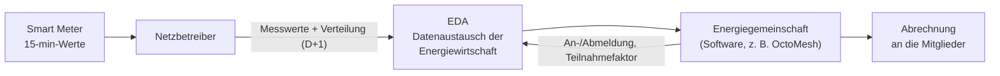

# 3 Energiegemeinschaften fachlich

## Grundidee

Eine **Energiegemeinschaft** ist ein Zusammenschluss von Haushalten, Betrieben,
Gemeinden oder Vereinen, die Strom gemeinsam erzeugen und untereinander
verbrauchen. Typisch: Eine PV-Anlage auf dem Dach eines Betriebs liefert mittags
mehr, als der Betrieb braucht. Der Überschuss geht nicht zum Marktpreis ins Netz,
sondern zu einem günstigen, intern vereinbarten Preis an die Nachbarn in der
Gemeinschaft. Physisch fließt der Strom weiterhin über das öffentliche Netz; die
Gemeinschaft ist eine **bilanzielle** Konstruktion.

## Rechtsrahmen in Österreich

Die EU hat Energiegemeinschaften im *Clean Energy Package* (2018/2019) verankert.
Österreich hat das 2021 umgesetzt:

| Form | Rechtsgrundlage | Kurzbeschreibung |
|---|---|---|
| **Erneuerbare-Energie-Gemeinschaft (EEG)** | Erneuerbaren-Ausbau-Gesetz (EAG 2021) | nur erneuerbare Erzeugung; räumlich begrenzt auf das Netz unter einem Umspannwerk (*regional*) oder einer Trafostation (*lokal*); dafür reduzierte Netzentgelte für den intern verteilten Strom |
| **Bürgerenergiegemeinschaft (BEG)** | Elektrizitätswirtschafts- und -organisationsgesetz (ElWOG 2010, Novelle 2021) | jede Erzeugungsart, österreichweit; keine Netzentgeltreduktion |

Mitglieder bleiben Kunden ihres Stromlieferanten für alles, was die Gemeinschaft
nicht deckt. Ein Zählpunkt kann an **mehreren** Gemeinschaften teilnehmen
(Mehrfachteilnahme); ein **Teilnahmefaktor** (in OctoMesh `PartitionFactor`,
1 bis 100 %) legt fest, welcher Anteil auf welche Gemeinschaft entfällt. Das
Thema vertieft Labor 3.

## Rollen und Datenfluss

- Der **Netzbetreiber** misst mit Smart Metern jede **Viertelstunde** (96 Werte pro
  Tag, 92 bzw. 100 an Tagen der Zeitumstellung) Bezug und Einspeisung.
- Er berechnet am Folgetag (**D+1**) die **Verteilung**: Welcher Teil des
  Verbrauchs jedes Mitglieds in jeder Viertelstunde aus der Erzeugung der
  Gemeinschaft gedeckt wurde. Verteilt wird nur, was **im selben Slot** erzeugt
  wurde; Energie lässt sich nicht von mittags auf abends verschieben.
- Die Daten gehen über **EDA** (Energiewirtschaftlicher Datenaustausch), die
  gemeinsame Austauschplattform der österreichischen Netzbetreiber, an die
  Gemeinschaft.
- Die Gemeinschaft **rechnet ab**: Verbraucher zahlen für ihren gedeckten Anteil,
  Erzeuger bekommen eine Gutschrift für die verteilte Energie.

Im Labor gibt es keine echten Netzbetreiber und kein EDA. Die Messwerte kommen aus
der **Simulation** und, später, von euren **eigenen Zählern**.

## Verteilschlüssel

| Schlüssel | Regel | Folge |
|---|---|---|
| **statisch** | Jedes Mitglied bekommt einen festen Anteil der Erzeugung | einfach; ein Anteil kann ungenutzt bleiben, wenn das Mitglied gerade wenig verbraucht |
| **dynamisch** | Die Erzeugung wird im Verhältnis zum aktuellen Verbrauch verteilt, höchstens bis zum eigenen Verbrauch | nutzt die Erzeugung besser; **Standard im Labor** |

## Verbraucher, Erzeuger, Speicher

- **Verbraucher** (Consumer-Zählpunkt): misst Bezug aus dem Netz.
- **Erzeuger** (Producer-Zählpunkt): misst Einspeisung ins Netz, meist PV.
- **Speicher** gibt es nicht als eigenen Zählpunkttyp. Im Labor wird ein Speicher
  als **zwei Zähler** modelliert: Laden = Verbraucher, Entladen = Erzeuger. Eine
  Gruppe kann so eine Batterie bauen, die mittags Überschuss aufnimmt und abends
  abgibt, und sieht die Wirkung im Deckungsgrad.

## Register und Kennzahlen

Die Bedeutung jedes Werts steckt im **OBIS-Code** (Register):

| Register | Bedeutung |
|---|---|
| `1-1:1.9.0 G.01` | Verbrauch eines Verbrauchers (gemessen) |
| `1-1:2.9.0 G.01` | Erzeugung eines Erzeugers (gemessen) |
| `1-1:2.9.0 G.03` | Eigendeckung: Anteil des Verbrauchs aus der Gemeinschaft (wird abgerechnet) |
| `1-1:2.9.0 G.01T` | in die Gemeinschaft eingebrachte Erzeugung (Erzeugung × Teilnahmefaktor) |
| `1-1:2.9.0 P.01T` | davon nicht verteilt: **Überschuss** |

Pro Viertelstunde gilt: Σ G.03 = Σ (G.01T − P.01T). Zwei Kennzahlen beschreiben
eine Gemeinschaft:

- **Deckungsgrad D** = Σ G.03 / Σ `1.9.0 G.01`: wie viel des Verbrauchs aus eigener
  Erzeugung kommt.
- **Überschussquote U** = Σ P.01T / Σ G.01T: wie viel der eingebrachten Erzeugung
  keinen Abnehmer fand.

Jeder Wert hat eine **Datenqualität**: `L1` gemessen, `L2` interpoliert, `L3`
geschätzt, `Manual` von Hand korrigiert. Abgerechnet wird nur L1 und L2.

Weiterführend: Tutorial
[Understanding energy data](https://docs.meshmakers.cloud/docs/tutorials/energyData)
mit Beispielabfragen und Übungen.
