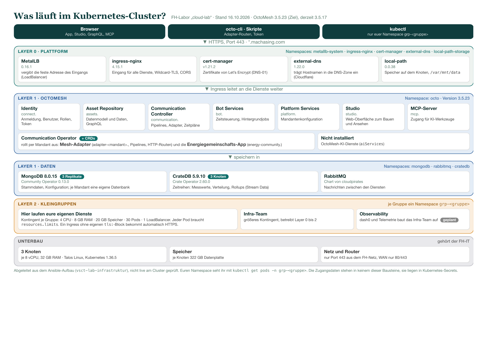

# 12 Was läuft im Kubernetes-Cluster?

Eine Übersicht über alles, was im FH-Cluster „cloud-lab“ installiert ist: von den Zugängen oben bis zu den
Servern unten. Die Schichten entsprechen dem Aufbau, den das Infra-Team betreibt.

[Als PDF (A4 quer)](images/kubernetes-uebersicht.pdf)

## So lest ihr die Grafik

- **Von oben nach unten** läuft eine Anfrage: Browser, octo-cli oder Skript → Ingress (Port 443) → OctoMesh-Dienste →
  Datenbanken.
- **Layer 0 (Plattform)** sorgt für Adresse, Eingang, Zertifikate, DNS und Speicher.
- **Layer 1 (OctoMesh und Daten)** ist die Anwendung: Identity, Datenmodell, Pipelines, Studio, MCP-Server
  sowie MongoDB, CrateDB und RabbitMQ.
- **Layer 2 (Kleingruppen)** ist euer Gebiet: Im eigenen Namespace `grp-<gruppe>` laufen eure eigenen Dienste.
- **Unterbau** (Knoten, Netz) gehört der FH-IT.

## Wo ihr was seht

| Wollt ihr sehen … | So |
|---|---|
| eure Pods | `kubectl get pods -n grp-<gruppe>` (mit eurer kubeconfig, nach Labor 2) |
| die OctoMesh-Dienste | `https://studio.machasing.com`, `https://connect.machasing.com`, `https://assets.machasing.com` |
| eure Mandanten-Daten | Studio und die Energiegemeinschafts-App ([Seite 4](04-daten-und-simulation.md)) |

**Stand:** Die Grafik ist aus dem Aufbau des Clusters abgeleitet (Stand 16.10.2026) und nicht live am Cluster
geprüft. OctoMesh läuft derzeit mit 3.5.17, das Update auf 3.5.23 ist für den 19.10. geplant.
